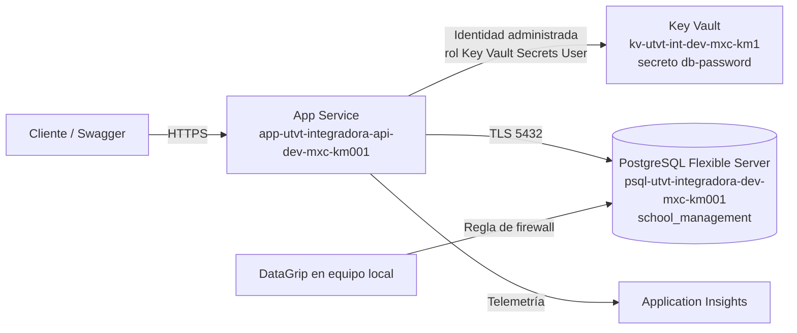
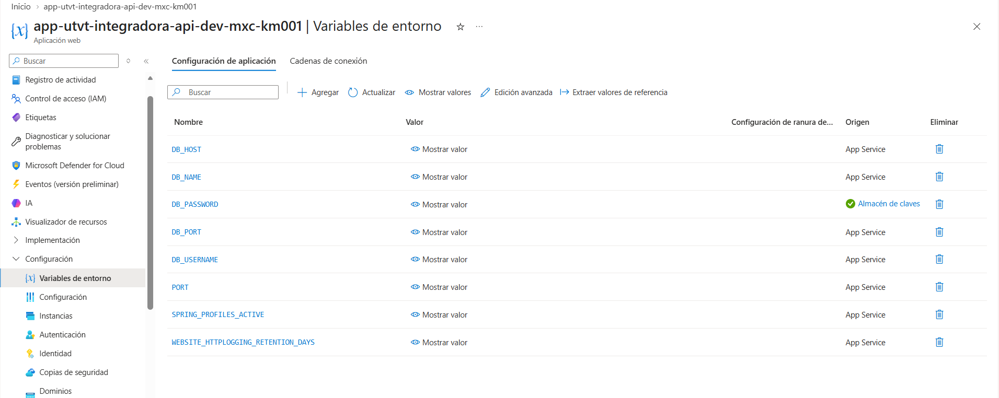

# Laboratorio I. Key Vault

Despliegue de una API Spring Boot en **Azure App Service** conectada a **Azure Database for PostgreSQL – Flexible Server**, con la contraseña de la base de datos guardada en **Azure Key Vault** y leída por el App Service mediante su **identidad administrada** y **RBAC**.

- **Alumna:** Kenia Medina Gil
- **Carrera:** Ingeniería en Desarrollo y Gestión de Software — Universidad Tecnológica del Valle de Toluca
- **Materia:** Aplicaciones Web Progresivas
- **Profesor:** Jorge Almeida Montiel
- **Fecha:** 8 de noviembre de 2026

> El código de la API es el del repositorio del profesor: [jorgealmeidamontiel/school-management-api](https://github.com/jorgealmeidamontiel/school-management-api). Este repositorio contiene los comandos, la documentación y las evidencias de la práctica.

## Objetivo

Que la API se conecte a PostgreSQL **sin guardar la contraseña en el código ni en texto plano** en la configuración. La variable `DB_PASSWORD` del App Service es una referencia al secreto `db-password` del Key Vault, y App Service la resuelve en tiempo de ejecución con su identidad administrada.

## Arquitectura



## Recursos desplegados

Región **Mexico Central**, grupo de recursos `rg-utvt-integradora-dev-mxc-001`, etiquetas `cost_center=utvt`, `environment=dev`, `managed_by=cli` y `owner=equipo-integradora`.

| Recurso | Nombre | Configuración |
|---|---|---|
| Grupo de recursos | `rg-utvt-integradora-dev-mxc-001` | Mexico Central |
| PostgreSQL Flexible Server | `psql-utvt-integradora-dev-mxc-km001` | PostgreSQL 16.15, Burstable B1ms, usuario `adminpgdev`, base `school_management` |
| Plan de App Service | `asp-utvt-integradora-dev-mxc-001` | Linux, nivel Gratis (F1) |
| App Service | `app-utvt-integradora-api-dev-mxc-km001` | Java SE, HTTPS, identidad asignada por el sistema |
| Key Vault | `kv-utvt-int-dev-mxc-km1` | SKU Estándar, modelo RBAC, secreto `db-password` |
| Log Analytics | `log-utvt-integradora-dev-mxc-001` | Área de trabajo de telemetría |
| Application Insights | `app-utvt-integradora-api-dev-mxc-km001` | Peticiones y dependencias de la API |

## Estructura del repositorio

```
.
├── README.md
├── scripts/                 Comandos de Azure CLI (PowerShell) usados en la práctica
│   ├── 00-variables.ps1
│   ├── 01-grupo-recursos.ps1
│   ├── 02-postgresql.ps1
│   ├── 03-key-vault.ps1
│   ├── 04-app-service.ps1
│   ├── 05-variables-entorno.ps1
│   ├── 06-compilar-desplegar.ps1
│   ├── 07-secreto-identidad.ps1
│   ├── 08-pruebas.ps1
│   └── 99-limpieza.ps1
└── docs/
    ├── Laboratorio_I_Key_Vault_Kenia_Medina_Gil.docx   Reporte de evidencias
    └── evidencias/                                     Capturas de pantalla
```

## Requisitos

- Suscripción de Azure (se usó Azure for Students)
- [Azure CLI](https://learn.microsoft.com/cli/azure/install-azure-cli) con sesión iniciada (`az login`)
- JDK y Maven para compilar la API
- Un cliente PostgreSQL (se usó DataGrip; también sirve pgAdmin)

## Pasos

Los scripts se ejecutan en PowerShell desde la carpeta `scripts`, en orden. Cada uno carga primero `00-variables.ps1`.

| Paso | Script | Qué hace |
|---|---|---|
| 1 | `01-grupo-recursos.ps1` | Crea el grupo de recursos con las etiquetas |
| 2 | `02-postgresql.ps1` | Crea el servidor PostgreSQL, la base y las reglas de firewall (servicios de Azure e IP local) |
| 3 | `03-key-vault.ps1` | Crea el Key Vault con RBAC y asigna al usuario el rol *Key Vault Administrator* |
| 4 | `04-app-service.ps1` | Crea el plan Linux F1 y el App Service con Java |
| 5 | `05-variables-entorno.ps1` | Configura `DB_HOST`, `DB_PORT`, `DB_NAME`, `DB_USERNAME`, `SPRING_PROFILES_ACTIVE` y `PORT` |
| 6 | `06-compilar-desplegar.ps1` | Compila el JAR con Maven y lo despliega |
| 7 | `07-secreto-identidad.ps1` | Guarda el secreto, activa la identidad administrada, asigna *Key Vault Secrets User* y pone la referencia en `DB_PASSWORD` |
| 8 | `08-pruebas.ps1` | Prueba POST y GET de la API |
| — | `99-limpieza.ps1` | Elimina el grupo de recursos al terminar |

Application Insights se habilitó desde el portal: **App Service → Supervisión → Application Insights → Activar**.

### Referencia al Key Vault

```text
DB_PASSWORD = @Microsoft.KeyVault(SecretUri=https://kv-utvt-int-dev-mxc-km1.vault.azure.net/secrets/db-password/)
```

La URI no lleva versión al final, así la aplicación siempre toma la versión más reciente del secreto. En el portal, el origen de `DB_PASSWORD` aparece como **Almacén de claves** con marca verde cuando la referencia se resuelve bien.

## Resultados

| Prueba | Resultado |
|---|---|
| `POST /api/v1/students` | **201 Created** (ids 1 y 2) |
| `GET /api/v1/students/1` | **200 OK** |
| `SELECT * FROM students` en DataGrip | Registro guardado en PostgreSQL |
| `DB_PASSWORD` en el App Service | Origen **Almacén de claves** ✔ |
| Application Insights | 12 operaciones y 154 llamadas de dependencia a PostgreSQL |

## Evidencias

| # | Evidencia |
|---|---|
| 1 | [Grupo de recursos](docs/evidencias/01-grupo-de-recursos.png) |
| 2 | [PostgreSQL – información general](docs/evidencias/02-postgresql-informacion-general.png) |
| 3 | [PostgreSQL – redes y firewall](docs/evidencias/03-postgresql-redes-firewall.png) |
| 4 | [DataGrip – tabla students](docs/evidencias/04-datagrip-tabla-students.png) |
| 5 | [Key Vault – información general](docs/evidencias/05-key-vault-informacion-general.png) |
| 6 | [Key Vault – modelo RBAC](docs/evidencias/06-key-vault-rbac.png) |
| 7 | [Key Vault – asignaciones de roles](docs/evidencias/07-key-vault-asignaciones-roles.png) |
| 8 | [App Service](docs/evidencias/08-app-service.png) |
| 9 | [Swagger UI](docs/evidencias/09-swagger-ui.png) |
| 10 | [Secreto db-password](docs/evidencias/10-secreto-db-password.png) |
| 11 | [Identidad administrada](docs/evidencias/11-identidad-administrada.png) |
| 12 | [Variables con referencia a Key Vault](docs/evidencias/12-variables-referencia-key-vault.png) |
| 13 | [POST 201](docs/evidencias/13-post-201.png) |
| 14 | [GET 200](docs/evidencias/14-get-200.png) |
| 15 | [DataGrip – SELECT](docs/evidencias/15-datagrip-select-students.png) |
| 16 | [Segundo POST 201](docs/evidencias/16-post-201-id2.png) |
| 17 | [Habilitar Application Insights](docs/evidencias/17-habilitar-application-insights.png) |
| 18 | [Variables de Application Insights](docs/evidencias/18-variables-application-insights.png) |
| 19 | [Application Insights – operaciones](docs/evidencias/19-app-insights-operaciones.png) |
| 20 | [Application Insights – dependencias](docs/evidencias/20-app-insights-dependencias.png) |



> Por seguridad, en las capturas se taparon los identificadores de suscripción y directorio, los correos y las direcciones IP.

## Problemas y soluciones

| Problema | Causa | Solución |
|---|---|---|
| DataGrip: "El intento de conexión falló" | La IP del equipo no estaba en el firewall de PostgreSQL | Crear la regla `MiIPCasa` con la IP actual |
| `28P01 password authentication failed` | Contraseña incorrecta | Obtenerla del secreto con `az keyvault secret show ... \| Set-Clipboard` |
| Application Insights sin datos | El agente no estaba configurado y luego se revisaba un recurso distinto | Activarlo desde el App Service y consultar el recurso vinculado |
| `'app-insights' is misspelled or not recognized` | Faltaba la extensión de la CLI | Usar el portal o `az extension add -n application-insights` |
| `POST` 400 Bad Request | Fecha de nacimiento actual y matrícula con formato inválido | Enviar una fecha pasada y una matrícula numérica |
| `GET /students/2` 404 | El estudiante aún no existía | Crearlo primero con POST |

## Seguridad

- Ninguna contraseña está en este repositorio ni en el código. Los scripts la piden con `Read-Host -AsSecureString`.
- El usuario tiene *Key Vault Administrator*; el App Service solo tiene *Key Vault Secrets User* (lectura de secretos), aplicando mínimo privilegio.

## Limpieza

```powershell
az group delete -n rg-utvt-integradora-dev-mxc-001 --yes --no-wait
```

## Referencias

- [Acerca de Azure Key Vault](https://learn.microsoft.com/azure/key-vault/general/overview)
- [Referencias de Key Vault en App Service](https://learn.microsoft.com/azure/app-service/app-service-key-vault-references)
- [Azure Database for PostgreSQL – Flexible Server](https://learn.microsoft.com/azure/postgresql/flexible-server/overview)
- [Introducción a Application Insights](https://learn.microsoft.com/azure/azure-monitor/app/app-insights-overview)
- [Documentación de Azure CLI](https://learn.microsoft.com/cli/azure/)
